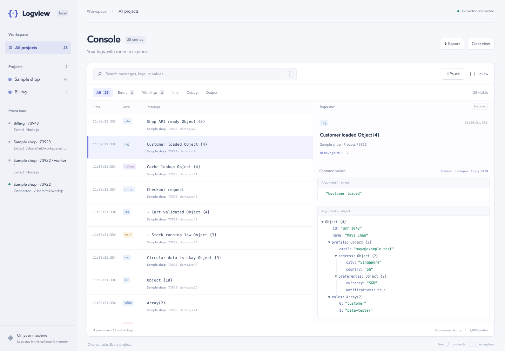

# Logview Local

[](https://github.com/mk-tdev/logview/actions/workflows/test.yml)

**A browser console for your Node.js logs. Install once, use across projects.**

Keep your existing `console.log()` calls and explore objects, arrays, errors, Maps, Sets, and circular references in an expandable local viewer. No imports or dependencies added to your projects.



## Install globally

Requires **Node.js 20 or newer** and npm.

> The first registry release is waiting for npm account 2FA verification. Until then, use the GitHub installation command below.

Install from npm:

```sh
npm install -g logview-local
```

This installs the **`logview-local`** command. No global project configuration or build step is required.

You can also install directly from the public GitHub repository:

```sh
npm install -g github:mk-tdev/logview
```

## Quick start

Run the included sample:

```sh
logview-local demo
```

Open **http://127.0.0.1:4317**. Select **Customer loaded** and expand `profile` → `address`. The snapshot shows `Singapore` even though the app changes that value immediately after logging it.

In any existing Node project, prefix your usual command:

```sh
logview-local npm run dev
```

More examples:

```sh
logview-local node app.js
logview-local npx tsx src/index.ts
logview-local npx nodemon app.js
logview-local run --project payments -- npm run dev
```

Use an explicit `--` when you need to separate Logview options from command arguments:

```sh
logview-local run -- node app.js --port 3000
logview-local run --port 4320 --project api -- npm run dev
```

Your terminal output continues normally. The launcher starts a collector if needed or connects to an existing one. Only commands started through Logview are captured.

## Multiple projects, one dashboard

Start a shared collector in one terminal:

```sh
logview-local serve
```

Then run each project through Logview in its own terminal:

```sh
# From the API project directory:
logview-local run --project api -- npm run dev

# From the worker project directory:
logview-local run --project worker -- npm start
```

Both appear in the same dashboard. Filter by project or process in the sidebar.

A launcher connected to an existing collector returns its command's exit code and leaves the shared collector running. A launcher that starts its own collector keeps serving history after its command exits. Press **Ctrl+C** in the owning terminal to stop its command tree and collector. History disappears when the collector closes.

## Commands and options

| Command | Purpose |
| --- | --- |
| `logview-local <command> [args...]` | Run and capture a command. |
| `logview-local run -- <command> [args...]` | Explicit run form. |
| `logview-local serve` | Start a shared collector without an application. |
| `logview-local demo` | Run the bundled sample and stream new logs. |
| `logview-local demo -- --once` | Emit the showcase once; keep owned collector history available. |
| `logview-local --help` | Show usage. |
| `logview-local --version` | Show the installed version. |

| Option | Default | Purpose |
| --- | --- | --- |
| `--port <number>` | `4317`, or `LOGVIEW_PORT` | Collector port. |
| `--project <name>` | Current directory name | Label processes in the sidebar. |

Logview options go before the command or its `--` separator. `--port` selects the collector's port, not your application's port. Open the localhost URL printed by the launcher; it does not automatically open your browser.

The bundled sample covers nested data, circular references, special JavaScript types, getters, errors with causes, assertions, timers, counters, groups, tables, format placeholders, multiline strings, JSON logs, raw stream output, partial lines, a forked process, and a worker thread. It requires no accounts, API keys, or extra packages.

## Viewer

- Select a log and expand its captured arguments independently.
- Search keys and values, including captured descendants that are collapsed.
- Filter errors, warnings, info, debug, raw output, projects, and processes.
- Pause rendering while capture continues. Resume displays retained history.
- Disable **Follow** to keep your scroll position while logs arrive.
- Click a source location to open VS Code using its URL handler.
- **Copy JSON** copies the selected entry's typed argument snapshots; **Export** downloads the currently filtered entries as JSON.
- **Clear view** hides existing entries in this browser tab. Other viewers retain their history; reloading restores the collector’s retained entries.
- Press `/` to search, then use arrow keys outside the input to select entries.

## How capture works

The launcher adds the bundled CommonJS capture module to `NODE_OPTIONS=--require …` only for the launched command. It preserves existing `NODE_OPTIONS`. The preload wraps `console.*` and the stdout/stderr `write` methods, calls the original methods, and sends bounded snapshots to the loopback collector. It is runtime instrumentation; your application source is unchanged.

Console values are captured before terminal formatting. Direct stdout/stderr writes are assembled into lines; valid JSON is parsed into expandable values. Numeric JSON log levels such as Pino's `30`, `40`, and `50` map to info, warning, and error. Existing `debug` output is captured when enabled by the app’s usual `DEBUG` setting. Capture does not enable disabled logs.

Node child processes and worker threads normally inherit the preload. Worker console forwarding is suppressed in parent capture to avoid duplicate entries. The viewer receives initial history and incremental events over **Server-Sent Events**; no WebSocket dependency or build step is needed.

Events are batched asynchronously, with a bounded synchronous helper at process exit for final delivery, including explicit `process.exit()`. Uncaught exceptions are observed with `uncaughtExceptionMonitor`; Node's crash behavior is preserved.

## Limits of this first version

- Intended for **local development**. Automated integration and global-package tests pass on Linux with Node.js 20, 22, and 24, and macOS with Node.js 24. Windows is not yet verified.
- Capture applies to commands launched through Logview, not arbitrary processes already running on your machine.
- Logs written only to files, direct filesystem writes to file descriptors, native subprocess logs that bypass Node stream methods, and processes that remove the preload/environment are not captured.
- Worker threads that explicitly opt out of inherited preloads are unsupported. A parent that manually forwards a captured child's piped output can create duplicate text entries.
- `SIGKILL` cannot flush final logs. Signal-terminated processes may remain marked connected until the collector restarts; there is no process-health polling yet.
- The collector keeps up to **2,000 events or 16 MiB**, whichever comes first, and 100 process records. Lifecycle events also count toward retention. There is no on-disk persistence.
- Each snapshot has a depth limit of 16, 100 children per object, 3,000 nodes, a 20,000-character per-string limit, and a shared 200,000-character string budget. Omitted data is marked. Search covers captured values only.
- Getters, custom inspectors, and `toJSON` are not deliberately evaluated. Proxy reflection traps can execute. Private fields and inherited properties are not captured. Tables appear as expandable row arrays rather than a spreadsheet.
- Snapshots represent capture-time values; they are not live object references. JSON copying/export preserves this typed snapshot format, including reference and truncation markers.
- Capture has serialization, stack collection, and network overhead. Queues are bounded to 500 pending events / 4 MiB; entries can be dropped under load or when the collector is unavailable. Exit-time delivery is best-effort and bounded to roughly 1.8 seconds. The interface is not virtualized for sustained high-volume logging.
- The server binds only to `127.0.0.1`, checks Host/Origin, and authenticates ingestion with a session token. This is not an isolation boundary against other applications running as your local user. Captured values may contain secrets; there is no automatic redaction.

## Develop and test

```sh
git clone https://github.com/mk-tdev/logview.git
cd logview
npm run check
npm test
npm run test:package
npm run demo
```

There are no runtime or development dependencies to install. The package smoke test builds a tarball, installs it into a temporary global npm prefix whose path contains spaces, invokes the actual `logview-local` executable, captures an unrelated project, and runs the bundled demo. Temporary files are removed afterward.

For local development, `npm link` makes your checkout available as the global `logview-local` command. See [PUBLISHING.md](PUBLISHING.md) for registry release instructions and [CHANGELOG.md](CHANGELOG.md) for releases.

Integration tests launch real Node processes against an ephemeral loopback collector. They cover capture-time snapshots, console/stdout deduplication, explicit exits and crashes, child and worker capture, authentication and retention, live streaming, CLI reuse, the sample app, and an unavailable collector.

Source files:

```text
bin/logview.cjs       Launcher and command lifecycle
lib/capture.cjs       Automatically preloaded capture hook
lib/snapshot.cjs      Bounded, typed object snapshots
lib/deliver.cjs       Exit-time delivery helper
lib/server.cjs        Local collector, retention, and SSE stream
web/                 Buildless browser viewer
examples/            Ordinary Node.js sample apps
test/                Node integration tests
```

The typed snapshot serializer was adapted from Object Inspector (MIT). Logview includes its own copy and runs independently. See [LICENSE](LICENSE).
